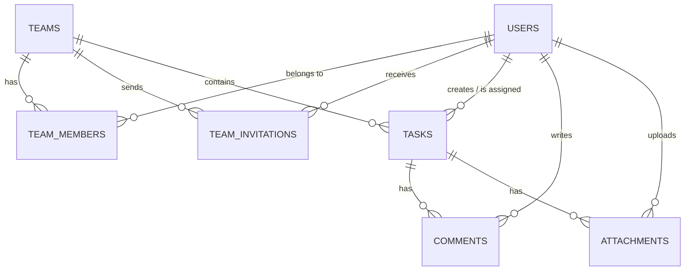

# TaskMaster: Collaborative Task Tracking System

A RESTful backend for a team task-tracking application. Users register and log in with JWT authentication, create teams and invite members, create and assign tasks, collaborate through comments and file attachments, receive real-time notifications, and generate task descriptions or summaries with generative AI.

## Table of Contents

- [Tech Stack](#tech-stack)
- [Features](#features)
- [Project Structure](#project-structure)
- [Data Model](#data-model)
- [Getting Started](#getting-started)
- [Postman Collection](#postman-collection)
- [SQL Scripts](#sql-scripts)
- [Environment Variables](#environment-variables)
- [API Reference](#api-reference)
- [Error Format](#error-format)
- [Real-Time Notifications](#real-time-notifications)
- [Generative AI](#generative-ai)
- [Testing](#testing)
- [Design Decisions](#design-decisions)
- [Known Limitations and Future Improvements](#known-limitations-and-future-improvements)

## Tech Stack

| Area | Technology |
|---|---|
| Language | Java 21 |
| Framework | Spring Boot 4.1 (Spring Web MVC, Spring Data JPA, Spring Security, Validation) |
| Database | PostgreSQL 15 |
| Schema migrations | Flyway |
| ORM | Hibernate 7 |
| Authentication | JWT (JJWT 0.12) with BCrypt password hashing |
| Real-time updates | Server-Sent Events (SSE) |
| Generative AI | OpenRouter (OpenAI-compatible Chat Completions API) |
| Build | Maven |
| Other | Lombok |

## Features

All user stories from the assignment brief are implemented, including both optional extensions.

| User story | Implementation |
|---|---|
| Create an account | `POST /api/auth/register` (returns a token, so the user is logged in immediately) |
| Log in securely | `POST /api/auth/login` with BCrypt password verification; issues a JWT |
| View and update profile | `GET` / `PUT /api/users/me`, plus `PUT /api/users/me/password` |
| Create a task with title, description and due date | `POST /api/tasks` (personal or team task) |
| View all tasks assigned to me | `GET /api/tasks?scope=ASSIGNED_TO_ME` |
| Mark a task as completed | `PATCH /api/tasks/{id}/status` with `{"status": "COMPLETED"}` |
| Assign a task to another team member | `PATCH /api/tasks/{id}/assignee` (assignee must be a team member) |
| Filter tasks by status | `GET /api/tasks?status=OPEN` |
| Search tasks by title or description | `GET /api/tasks?search=homepage` (case-insensitive) |
| Comments and attachments | `/api/tasks/{id}/comments` and `/api/tasks/{id}/attachments` |
| Create a team and invite members | `POST /api/teams`, `POST /api/teams/{id}/invitations`, accept or decline |
| Log out securely | `POST /api/auth/logout` revokes the token server-side |
| *(Optional)* Notifications on assignment or update | SSE stream at `GET /api/notifications/stream` |
| *(Optional)* AI-generated task descriptions or summaries | `POST /api/ai/task-description`, `POST /api/ai/tasks/{id}/summary` |

Also included: sorting, pagination, role-based team permissions (OWNER / MEMBER), consistent error responses, and request validation.

## Project Structure

```
src/main/java/com/taskmaster/taskmaster
├── ai/              OpenRouter API client
├── config/          Security configuration and typed properties (JWT, storage, AI)
├── controller/      REST controllers (HTTP layer only)
├── dto/             Request and response records, grouped by feature
├── entity/          JPA entities
├── enums/           Task status, priority, team role, invitation status, notification type
├── exception/       Custom exceptions and the global error handler
├── notification/    SSE connection registry, notification publisher and events
├── repository/      Spring Data repositories and dynamic task query specifications
├── security/        JWT service, authentication filter, user details, token cleanup job
└── service/         Business logic and access checks

src/main/resources
├── application.properties
└── db/migration/V1__create_tables.sql   Flyway schema script

database/
├── 01_setup_database.sql                Creates the database user and database
└── 02_verify_data.sql                   Read-only queries to check data after API calls

postman/
└── TaskMaster.postman_collection.json   Postman collection with all API requests
```

Request flow: **Controller** (validates input) → **Service** (business rules and permissions) → **Repository** (database). Controllers never return entities; they always return DTOs, so internal fields such as password hashes are never exposed.

## Data Model



| Table | Purpose |
|---|---|
| `users` | Accounts; passwords stored only as BCrypt hashes |
| `teams` | Teams or projects |
| `team_members` | User-to-team link with role `OWNER` or `MEMBER` (unique per team and user) |
| `team_invitations` | Invitations with status `PENDING`, `ACCEPTED` or `DECLINED` (at most one pending invitation per user per team) |
| `tasks` | Tasks; `team_id` is null for personal tasks, `assignee_id` is null when unassigned |
| `comments` | Comments on tasks |
| `attachments` | File metadata; the files themselves are stored on disk |
| `revoked_tokens` | IDs of logged-out JWTs until they expire |

The full schema, including constraints and indexes, is in `src/main/resources/db/migration/V1__create_tables.sql`.

## Getting Started

### Prerequisites

- JDK 21
- PostgreSQL 15 or later
- Maven 3.9+ (or use the included Maven wrapper)
- An OpenRouter API key (optional, only for the AI endpoints): https://openrouter.ai/keys

### 1. Create the database

Open [`database/01_setup_database.sql`](database/01_setup_database.sql), replace `change-me` with your own password, and run it as a PostgreSQL administrator (for example in pgAdmin's Query Tool or `psql -U postgres`). Run each statement **separately**, because `CREATE DATABASE` can't run together with other statements:

```sql
CREATE USER taskmaster_user WITH PASSWORD 'change-me';
CREATE DATABASE taskmaster_db OWNER taskmaster_user;
GRANT ALL PRIVILEGES ON DATABASE taskmaster_db TO taskmaster_user;
```

You don't need to create any tables. Flyway creates them automatically on the first start.

### 2. Generate a JWT secret

The secret must be Base64-encoded and at least 256 bits. In PowerShell:

```powershell
$b = New-Object byte[] 64; [Security.Cryptography.RandomNumberGenerator]::Create().GetBytes($b); [Convert]::ToBase64String($b)
```

On Linux or macOS:

```bash
openssl rand -base64 64 | tr -d '\n'
```

### 3. Set the environment variables

See [Environment Variables](#environment-variables). At minimum, set `DB_USERNAME` and `DB_PASSWORD`.

**IntelliJ IDEA:** Run → Edit Configurations → TaskmasterApplication → Environment variables:

```
DB_USERNAME=taskmaster_user;DB_PASSWORD=choose-a-password;JWT_SECRET=your-generated-secret;OPENROUTER_API_KEY=sk-or-v1-...
```

**Windows Command Prompt:**

```
set DB_USERNAME=taskmaster_user
set DB_PASSWORD=choose-a-password
set JWT_SECRET=your-generated-secret
set OPENROUTER_API_KEY=sk-or-v1-...
```

**Linux / macOS:**

```bash
export DB_USERNAME=taskmaster_user
export DB_PASSWORD=choose-a-password
export JWT_SECRET=your-generated-secret
export OPENROUTER_API_KEY=sk-or-v1-...
```

### 4. Run the application

From IntelliJ, run `TaskmasterApplication`, or from a terminal in the project folder (in the same window where you set the variables):

```bash
mvn spring-boot:run
```

The API is available at `http://localhost:8080`. On startup, the console shows:

```
Successfully applied 1 migration to schema "public"     (first run only)
AI (OpenRouter) enabled - model: openrouter/free        (or "disabled" if no key is set)
Started TaskmasterApplication
```

## Postman Collection

All API requests are available as a Postman collection:

```
postman/TaskMaster.postman_collection.json
```

**To import:**

1. Open Postman and click **Import** (top left).
2. Drag in `postman/TaskMaster.postman_collection.json`, or click **files** and select it.
3. Click **Import**. The collection appears in the **Collections** sidebar.

**To use it:**

1. Start the application.
2. Run **Register** (or **Login**) and copy the `accessToken` from the response.
3. Open the collection → **Authorization** tab → Auth Type **Bearer Token** → paste the token → **Save**. Requests set to *Inherit auth from parent* now use it.
4. To act as a different user (for example to test permissions or notifications), set that user's token in the individual request's **Authorization** tab.

Path IDs in the requests (task, team, comment, attachment and invitation IDs) refer to the data created while testing; replace them with IDs from your own responses.

**Uploading attachments:** in the upload request, go to **Body** → **form-data**, make sure the key is `file` with type **File**, and select a file from your computer.

**Notifications:** send the stream request in one tab (it keeps running) and perform actions as another user in a second tab.

## SQL Scripts

The `database` folder contains two helper scripts. The application schema itself is created by Flyway from `src/main/resources/db/migration/V1__create_tables.sql`.

| File | Purpose | Run as |
|---|---|---|
| [`database/01_setup_database.sql`](database/01_setup_database.sql) | Creates the `taskmaster_user` user and the `taskmaster_db` database (once, before the first start) | PostgreSQL administrator, connected to `postgres` |
| [`database/02_verify_data.sql`](database/02_verify_data.sql) | Read-only `SELECT` queries to check the data after calling the API | Any user, connected to `taskmaster_db` |

`02_verify_data.sql` contains numbered queries. Select one and press **F5** in pgAdmin to run it:

| # | Query | Use it to verify |
|---|---|---|
| 0 | Row count per table | Overall state of the database |
| 1 | Users | Registration; passwords are stored as BCrypt hashes (`$2a$...`) |
| 2 | Teams with owner and member count | Team creation and accepted invitations |
| 3 | Team members and roles | OWNER / MEMBER roles |
| 4 | Invitations | Invite, accept and decline |
| 5 | Tasks with team, creator and assignee | Create, update, status change, assign, delete |
| 6 | Task count by status | `GET /api/tasks?status=...` |
| 7 | Tasks assigned to one user | `GET /api/tasks?scope=ASSIGNED_TO_ME` (edit the email) |
| 8 | Search check | `GET /api/tasks?search=...` (edit the search text) |
| 9 | Comments | Add and delete comments |
| 10 | Attachments | Upload and delete; `storage_path` is relative to the `uploads` folder |
| 11 | Revoked tokens | Logout, and the hourly cleanup of expired tokens |
| 12 | Flyway history | Applied schema migrations |

## Environment Variables

| Variable | Required | Default | Description |
|---|---|---|---|
| `DB_USERNAME` | Yes | — | PostgreSQL user |
| `DB_PASSWORD` | Yes | — | PostgreSQL password |
| `DB_URL` | No | `jdbc:postgresql://localhost:5432/taskmaster_db` | JDBC URL |
| `JWT_SECRET` | Recommended | Dev-only key | Base64 HMAC key, at least 256 bits. **Always set this outside local development.** |
| `JWT_EXPIRATION_MINUTES` | No | `60` | Token lifetime |
| `OPENROUTER_API_KEY` | No | — | Enables the AI endpoints; without it they return 503 |
| `OPENROUTER_MODEL` | No | `openrouter/free` | Any OpenRouter model ID, e.g. `meta-llama/llama-3.3-70b-instruct:free` |
| `UPLOAD_DIR` | No | `uploads` | Folder for attachment files (created automatically) |
| `SERVER_PORT` | No | `8080` | HTTP port |

## API Reference

All endpoints except register and login require the header:

```
Authorization: Bearer <accessToken>
```

### Authentication

| Method | Endpoint | Description | Success |
|---|---|---|---|
| POST | `/api/auth/register` | Create an account | 201 + token |
| POST | `/api/auth/login` | Log in | 200 + token |
| POST | `/api/auth/logout` | Revoke the current token | 204 |

Register request:

```json
{ "fullName": "Priya Sharma", "email": "priya@example.com", "password": "Priya1234" }
```

Login response:

```json
{
  "accessToken": "eyJhbGciOiJIUzUxMiJ9...",
  "tokenType": "Bearer",
  "expiresIn": 3600,
  "user": { "id": 1, "fullName": "Priya Sharma", "email": "priya@example.com", "createdAt": "...", "updatedAt": "..." }
}
```

Password rules: 8 to 72 characters, with at least one letter and one digit.

### Profile

| Method | Endpoint | Description | Success |
|---|---|---|---|
| GET | `/api/users/me` | View my profile | 200 |
| PUT | `/api/users/me` | Update my full name: `{"fullName": "..."}` | 200 |
| PUT | `/api/users/me/password` | Change password: `{"currentPassword": "...", "newPassword": "..."}` | 204 |

### Teams and Invitations

| Method | Endpoint | Who | Success |
|---|---|---|---|
| POST | `/api/teams` | Any user (creator becomes OWNER) | 201 |
| GET | `/api/teams` | Teams I belong to, with my role | 200 |
| GET | `/api/teams/{teamId}` | Members | 200 |
| GET | `/api/teams/{teamId}/members` | Members | 200 |
| POST | `/api/teams/{teamId}/invitations` | Owner; body `{"email": "..."}` | 201 |
| GET | `/api/invitations` | My pending invitations | 200 |
| POST | `/api/invitations/{id}/accept` | Invited user (joins as MEMBER) | 200 |
| POST | `/api/invitations/{id}/decline` | Invited user | 200 |

### Tasks

| Method | Endpoint | Who | Success |
|---|---|---|---|
| POST | `/api/tasks` | Any user (team tasks: team members) | 201 |
| GET | `/api/tasks` | List, filter, search, sort, paginate | 200 |
| GET | `/api/tasks/{id}` | Anyone who can see the task | 200 |
| PATCH | `/api/tasks/{id}` | Creator or team owner | 200 |
| PATCH | `/api/tasks/{id}/status` | Assignee, creator or team owner | 200 |
| PATCH | `/api/tasks/{id}/assignee` | Assignee, creator or team owner | 200 |
| DELETE | `/api/tasks/{id}` | Creator or team owner | 204 |

**Visibility:** a team task is visible to all members of its team; a personal task (no `teamId`) only to its creator.

Create request (only `title` is required):

```json
{
  "title": "Design home page",
  "description": "Create the first draft",
  "dueDate": "2026-12-01",
  "priority": "HIGH",
  "teamId": 1,
  "assigneeId": 2
}
```

`PATCH /api/tasks/{id}` updates only the fields sent. Status values: `OPEN`, `IN_PROGRESS`, `COMPLETED`. Priority values: `LOW`, `MEDIUM`, `HIGH`. Assign with `{"assigneeId": 2}` or unassign with `{"assigneeId": null}`.

**List query parameters** for `GET /api/tasks`:

| Parameter | Values | Default |
|---|---|---|
| `scope` | `ALL`, `ASSIGNED_TO_ME`, `CREATED_BY_ME` | `ALL` |
| `teamId` | Team ID | — |
| `status` | `OPEN`, `IN_PROGRESS`, `COMPLETED` | — |
| `priority` | `LOW`, `MEDIUM`, `HIGH` | — |
| `search` | Text in title or description | — |
| `sortBy` | `dueDate`, `createdAt`, `updatedAt`, `title` | `dueDate` |
| `direction` | `asc`, `desc` | `asc` |
| `page` | 0-based page number | `0` |
| `size` | 1 to 100 | `20` |

Example: `GET /api/tasks?scope=ASSIGNED_TO_ME&status=OPEN&search=design&sortBy=dueDate`

Response:

```json
{
  "content": [ { "id": 7, "title": "...", "status": "OPEN", "...": "..." } ],
  "page": 0, "size": 20, "totalElements": 1, "totalPages": 1, "first": true, "last": true
}
```

### Comments

| Method | Endpoint | Who | Success |
|---|---|---|---|
| POST | `/api/tasks/{taskId}/comments` | Anyone who can see the task; body `{"content": "..."}` | 201 |
| GET | `/api/tasks/{taskId}/comments` | Anyone who can see the task (oldest first) | 200 |
| DELETE | `/api/tasks/{taskId}/comments/{commentId}` | Comment author or team owner | 204 |

### Attachments

| Method | Endpoint | Who | Success |
|---|---|---|---|
| POST | `/api/tasks/{taskId}/attachments` | Anyone who can see the task; `multipart/form-data` field `file`, max 10 MB | 201 |
| GET | `/api/tasks/{taskId}/attachments` | Anyone who can see the task | 200 |
| GET | `/api/tasks/{taskId}/attachments/{id}/download` | Anyone who can see the task | 200 + file |
| DELETE | `/api/tasks/{taskId}/attachments/{id}` | Uploader or team owner | 204 |

### Notifications and AI

| Method | Endpoint | Description | Success |
|---|---|---|---|
| GET | `/api/notifications/stream` | SSE stream of my notifications | 200 (`text/event-stream`) |
| POST | `/api/ai/task-description` | Generate a description: `{"title": "...", "notes": "..."}` | 200 |
| POST | `/api/ai/tasks/{taskId}/summary` | Summarize a task and its comments | 200 |

## Error Format

Every error, including authentication failures, uses the standard Problem Details format (RFC 9457):

```json
{
  "type": "about:blank",
  "title": "Not Found",
  "status": 404,
  "detail": "Task not found with id: 15",
  "instance": "/api/tasks/15",
  "timestamp": "2026-11-16T10:30:00Z"
}
```

Validation errors add an `errors` object with one message per invalid field:

```json
{
  "title": "Validation failed",
  "status": 400,
  "detail": "One or more fields are invalid",
  "errors": { "email": "Email must be a valid email address", "password": "Password is required" }
}
```

| Status | Meaning |
|---|---|
| 400 | Invalid input or a broken business rule |
| 401 | Missing, invalid, expired or revoked token; wrong email or password |
| 403 | Authenticated but not allowed (e.g. not a team member, not the owner) |
| 404 | Resource doesn't exist |
| 409 | Conflict with existing data (e.g. email already registered) |
| 413 | Uploaded file larger than 10 MB |
| 429 / 502 / 503 / 504 | AI service rate limit, error, not configured, or timeout |

Unexpected errors return 500 with a generic message; details are logged on the server only.

## Real-Time Notifications

Open a long-lived connection:

```
GET /api/notifications/stream
Authorization: Bearer <token>
```

The server pushes events as they happen:

```
event: TASK_ASSIGNED
data: {"type":"TASK_ASSIGNED","message":"Priya Sharma assigned you the task \"Fix navbar\"","taskId":4,"teamId":1,...}
```

| Event | Sent to |
|---|---|
| `TASK_ASSIGNED` | The new assignee |
| `TASK_UPDATED`, `TASK_STATUS_CHANGED`, `COMMENT_ADDED` | Task assignee and creator |
| `INVITATION_RECEIVED` | The invited user |

The person who made the change is never notified. Events are sent only after the database transaction commits. A heartbeat comment is sent every 25 seconds, and the stream closes when the token expires (at most 30 minutes); clients should reconnect with a valid token.

To try it in Postman, send the stream request in one tab and perform actions as another user in a second tab.

## Generative AI

The AI endpoints use [OpenRouter](https://openrouter.ai), which provides one API for many models. The default model, `openrouter/free`, routes each request to an available free model, so no payment is needed for testing.

- **Generate description:** returns suggested text only; nothing is saved. The client places the text in `POST /api/tasks` or `PATCH /api/tasks/{id}`, so the user can review it first.
- **Summarize task:** uses the task's details and most recent comments, with the same access rules as viewing the task.

Free models have lower rate limits and may be slower at busy times, so occasional 429 or 504 responses are expected. Set `OPENROUTER_MODEL` to choose a specific model.

## Testing

Unit tests for JWT creation and validation (no database needed):

```bash
mvn test -Dtest=JwtServiceTest
```

The full test suite also includes `TaskmasterApplicationTests`, which starts the whole application, so it needs PostgreSQL running and the `DB_USERNAME` / `DB_PASSWORD` environment variables set:

```bash
mvn test
```

## Design Decisions

| Decision | Reason |
|---|---|
| **Flyway migrations, `ddl-auto=validate`** | The schema is versioned in SQL and reviewable; Hibernate only verifies entities match it, so the app fails fast on any mismatch |
| **Stateless JWT with a revocation table** | No server sessions; logout still works because each token's unique ID (`jti`) is stored until the token expires, and an hourly job removes expired entries |
| **BCrypt password hashing** | Slow by design, salted per password |
| **DTOs instead of entities in responses** | Password hashes and internal fields are never exposed; input can't set fields like `id` |
| **Access checks in the service layer** | One reusable check per resource (`requireMembership`, `requireOwner`, `requireTaskAccess`) applied consistently across tasks, comments, attachments and AI |
| **Dynamic queries with JPA Specifications** | Any combination of filters, search and sorting without a separate method per combination; visibility rules are always applied first |
| **`@EntityGraph` on list queries** | Loads related users and teams in one query, avoiding the N+1 query problem |
| **Files on disk under random UUID names** | Prevents path-traversal attacks; files are written and deleted in sync with the database through transaction callbacks |
| **Notifications after commit** | Users are never notified about changes that were rolled back |
| **No database connection held during AI calls** | AI requests can take seconds; data is loaded first, then the AI is called outside the transaction |
| **Secrets via environment variables** | No real credentials are stored in the repository |

## Known Limitations and Future Improvements

- **Single instance:** SSE connections are held in memory. Running several instances would need a shared broker such as Redis Pub/Sub.
- **Local file storage:** attachments are stored on the server's disk; cloud object storage (e.g. Amazon S3) would suit production better.
- **Refresh tokens:** users log in again when the access token expires.
- **More tests:** integration tests for controllers and services (for example with Testcontainers).
- **API documentation UI:** OpenAPI / Swagger UI could be added.
- **Team management:** removing members, transferring ownership and deleting teams are not yet implemented.
